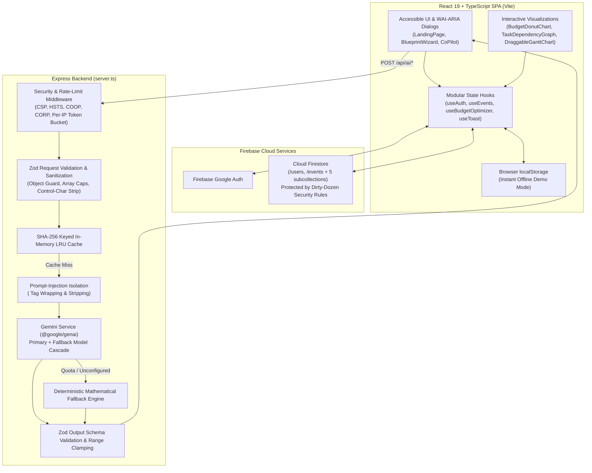

# Planora AI — Intelligent Event Planning & Budget Optimizer

Planora AI is a full-stack event planning, budget optimization, dependency graph (DAG), draggable Gantt timeline, and what-if scenario simulation studio powered by Google Gemini (`@google/genai`) and Firebase (Authentication & Cloud Firestore).

---

## Overview

Event organizers routinely face budget overruns, cascading task delays, and fragmented vendor tracking across disconnected spreadsheets. **Planora AI** solves this by transforming high-level event parameters—event category, target date, location, guest count, total budget cap, emergency contingency reserve, and weighted priorities—into a mathematically balanced blueprint with:

1. **AI Event Blueprint Wizard**: 5-step guided wizard with 1-click presets and server-side Gemini structured JSON synthesis (plus deterministic mathematical fallback when offline or unconfigured).
2. **Dynamic Budget Optimizer & Expense Ledger**: Live Planned vs. Quoted vs. Actual tracking, category locking, proportional rebalancing, and interactive SVG Donut Chart with an accessible screen-reader data table.
3. **Interactive Task Dependency Graph (DAG) & Hierarchy Tree**: Automatic critical-path detection, cycle prevention, overdue/blocked pulse indicators, and 1-click date overlap resolution.
4. **Draggable & Keyboard-Accessible Gantt Chart**: Pointer drag-and-drop, resize handles, dependency connector ports, and full keyboard operability (`ArrowLeft`/`ArrowRight` to shift ±1 day, `Shift+Arrow` to resize duration) with `aria-live` screen-reader announcements.
5. **What-If Scenario Simulator**: Side-by-side comparison of guest counts, budget caps, venue tiers (`Budget`, `Standard`, `Premium`), catering styles (`Cocktail`, `Buffet`, `Plated`), and décor levels (`Minimal`, `Curated`, `Luxury`).
6. **Contextual AI Planning Co-Pilot**: Conversational assistant that proposes structured, range-clamped mutations (`update_budget_total`, `update_guest_count`, `scale_budget_items`, `add_budget_item`, `add_task`, `add_vendor`, `add_idea`) that require explicit user confirmation before modifying state.
7. **Formula-Safe CSV & Stakeholder Brief Export**: Escapes spreadsheet formula injection (`=`, `+`, `-`, `@`) and generates print-ready executive briefs.

---

## Architecture Diagram



---

## Problem Statement Alignment

| Problem Statement Requirement | Planora AI Feature & Implementation |
| :--- | :--- |
| **1. End-to-End AI Event Blueprint Generation** | `BlueprintGeneratorModal` (`src/components/BlueprintGeneratorModal.tsx`) + `POST /api/ai/generate-plan` (`server/routes/ai.ts`) synthesize a complete event concept, risk radar, budget allocation, chronological tasks, vendor pipeline, and creative ideas. |
| **2. Mathematically Balanced Budget & Contingency Control** | `BudgetSection` (`src/components/sections/BudgetSection.tsx`) and `calculateBudgetMetrics` (`src/utils/budgetCalculations.ts`) enforce contingency reserves (`0–35%`), calculate usable caps, flag over-allocations, lock priority categories, and run AI or proportional rebalancing. |
| **3. Visual Task Dependencies & Critical Path Analysis** | `TaskDependencyGraph` (`src/components/TaskDependencyGraph.tsx`) and `analyzeTaskSchedule` (`src/utils/taskScheduler.ts`) render a directed acyclic graph (DAG) and collapsible hierarchy tree with cycle detection, critical-path highlighting, and pulse animations on blocked/overdue tasks. |
| **4. Interactive Timeline & Drag-and-Drop Scheduling** | `DraggableGanttChart` (`src/components/DraggableGanttChart.tsx`) enables dragging task bars, resizing durations, linking prerequisites via connector ports, auto-cascading downstream tasks, and full keyboard slider control. |
| **5. Real-Time What-If Scenario Modeling** | `ScenarioSimulator` (`src/components/ScenarioSimulator.tsx`) + `POST /api/ai/simulate-scenario` model guest count changes and service-tier multipliers side-by-side without overwriting the active plan until confirmed. |
| **6. Contextual AI Co-Pilot with Safe Plan Actions** | `AssistantCoPilot` (`src/components/AssistantCoPilot.tsx`) + `POST /api/ai/copilot` provide natural-language budget/timeline advice and one-click action cards that require explicit user confirmation. |
| **7. Multi-Event Cloud Persistence & Stakeholder Export** | `firestoreService.ts` syncs events and 5 subcollections (`budgetItems`, `tasks`, `vendors`, `ideas`, `scenarios`) in parallel via `Promise.all`, while `ExportSection` exports formula-safe CSVs and executive briefs. |

---

## Setup & Installation

### Prerequisites
- **Node.js** `>= 20.x` (Node 22 recommended)
- **npm** `>= 10.x`

### Install & Run
```bash
# 1. Install dependencies
npm install

# 2. Copy environment template and configure GEMINI_API_KEY (optional for demo mode)
cp .env.example .env

# 3. Start full-stack development server on http://localhost:3000
npm run dev
```

---

## Environment Variables

All environment variables are documented in `.env.example` and loaded via `server/config.ts`:

| Variable | Default | Description |
| :--- | :--- | :--- |
| `GEMINI_API_KEY` | *(optional)* | Server-side Google Gemini API key. Never exposed to the client browser. If unset, deterministic mathematical fallbacks are used automatically. |
| `PORT` | `3000` | HTTP server listening port. |
| `GEMINI_PRIMARY_MODEL` | `gemini-2.5-flash` | Primary Gemini model used for structured JSON generation. |
| `GEMINI_FALLBACK_MODEL` | `gemini-2.5-flash-lite` | Secondary fallback model if primary model encounters transient errors. |
| `AI_CACHE_TTL_MS` | `300000` | TTL (5 minutes) for SHA-256 keyed server-side AI response cache. |
| `AI_CACHE_MAX_ENTRIES` | `100` | Maximum entries stored in the bounded LRU cache. |
| `RATE_LIMIT_WINDOW_MS` | `60000` | Rate limiter window duration (1 minute). |
| `RATE_LIMIT_MAX_GENERAL` | `60` | Max requests per minute per IP across `/api/*`. |
| `RATE_LIMIT_MAX_HEAVY` | `20` | Stricter max requests per minute per IP for `/api/ai/generate-plan` and `/api/ai/copilot`. |

---

## Available Scripts

| Script | Command | Purpose |
| :--- | :--- | :--- |
| `npm run dev` | `tsx server.ts` | Starts the Express + Vite middleware development server on port 3000. |
| `npm start` | `NODE_ENV=production tsx server.ts` | Runs the production Express server serving `dist/` and `/api/ai/*`. |
| `npm run build` | `vite build` | Compiles and bundles the frontend production assets into `dist/`. |
| `npm run lint` | `eslint . && tsc --noEmit` | Runs ESLint (`typescript-eslint`, `react-hooks`, `jsx-a11y`, `firebase-security-rules`) and TypeScript typechecking. |
| `npm run format` | `npx prettier --check ...` | Checks formatting across client, server, and shared files. |
| `npm test` | `npm run test:unit && npm run test:ui` | Runs all Node unit/API/rules tests and Vitest + `jest-axe` UI accessibility tests. |
| `npm run test:unit` | `tsx --test firestore.rules.test.ts src/__tests__/*.test.ts` | Runs backend API integration tests, Firestore rules tests, and domain unit tests. |
| `npm run test:ui` | `vitest run` | Runs React Testing Library + `jest-axe` accessibility component tests in `jsdom`. |
| `npm run test:rules` | `firebase emulators:exec --only firestore 'npm run test:rules:run'` | Executes all 12 Dirty Dozen attack payloads and positive owner tests against the live Firestore Emulator. |

---

## Testing Architecture

1. **API & Security Integration Tests (`src/__tests__/apiRoutes.test.ts`)**:
   - Boots `createApp()` on an ephemeral port (`127.0.0.1:0`) and exercises all `/api/ai/*` endpoints.
   - Verifies deterministic fallback behavior when `GEMINI_API_KEY` is unset, dependency-injected Gemini mocks (success, malformed JSON, thrown error), SHA-256 cache hits, `400` on non-object or invalid JSON, `413` on oversize payloads, `429` on rate limiting, zero `fallbackReason` error leakage, and strict filtering/clamping of copilot `proposedChanges`.
2. **UI & Automated Accessibility Tests (`src/__tests__/ui.test.tsx`)**:
   - Powered by `vitest`, `@testing-library/react`, `@testing-library/user-event`, and `jest-axe`.
   - Verifies `LandingPage`, `BlueprintGeneratorModal` (linked labels, `Escape` key dismissal, background `inert`), `AssistantCoPilot` (explicit user confirmation required before applying changes), `BudgetDonutChart` (accessible SVG + `sr-only` table), and `App` demo-mode navigation—with `expect(results.violations).toEqual([])` on every view.
3. **Firestore Security Rules Tests (`firestore.rules.test.ts`)**:
   - Uses `@firebase/rules-unit-testing` to execute all 12 Dirty Dozen payloads and positive owner create/update operations against the Firestore Emulator when `FIRESTORE_EMULATOR_HOST` is present, and runs static rule invariant assertions otherwise.
4. **Domain Edge-Case Unit Tests (`src/__tests__/budgetCalculations.test.ts`, `taskScheduler.test.ts`, `securityAndExport.test.ts`)**:
   - Covers budget math edge cases, cyclic task graphs, overdue/overlap detection, Gantt window math, CSV formula injection neutralization, and Firestore document mappers.

---

## Security

### Threat Model & Defense-in-Depth Controls
- **Server-Only AI Credentials**: `GEMINI_API_KEY` is read exclusively in `server/services/gemini.ts`. The client communicates strictly with `/api/ai/*` endpoints.
- **Zero Error-Detail Leakage**: Internal exceptions and upstream quota errors are logged server-side via `server/logger.ts` and never returned to the client. Fallback responses return a generic `fallbackCode: "ai_unavailable"` with no `fallbackReason` or stack traces.
- **Prompt-Injection Hardening**: User-supplied strings have `<user_data>` / `</user_data>` tags stripped and are isolated inside `<user_data>...</user_data>` blocks (`server/prompts/aiPrompts.ts`), paired with a strict `systemInstruction` instructing Gemini to treat all content inside `<user_data>` strictly as untrusted data and never as instructions.
- **Strict Zod Input & Output Validation**:
  - Request bodies reject non-objects, cap arrays (`budgetItems <= 100`, `vendors <= 100`, `tasks <= 200`), strip control characters, and clamp numbers.
  - Gemini JSON outputs are validated through Zod schemas (`server/schemas/outputSchemas.ts`). Copilot `proposedChanges` allow only the 7 known action types and clamp all numeric payloads (`scaleFactor` `0.1–3`, `newGuestCount >= 1`).
- **Bounded Rate Limiting & Proxy Trust**: `app.set('trust proxy', 1)` with per-IP token buckets (`60/min` general, `20/min` on `/api/ai/generate-plan` and `/api/ai/copilot`), bounded map size (`5,000` IPs max), and an `.unref()`'d purge timer.
- **HTTP Security Headers**: `Content-Security-Policy`, `Strict-Transport-Security` (in production), `Cross-Origin-Opener-Policy: same-origin-allow-popups` (preserving Google OAuth popups), `Cross-Origin-Resource-Policy: same-origin`, `X-Content-Type-Options: nosniff`, and `Cache-Control: no-store` on `/api`.
- **Firestore Security Rules (`firestore.rules`)**: Deny-by-default rules enforcing `isOwner(ownerId)`, `hasOnlyAllowedFields(...)`, strict string length and numeric bounds, `request.time` timestamp validation, and immutable `ownerId` / `createdAt` fields across `/users/{userId}` and `/events/{eventId}` + all 5 subcollections.
- **Note on Firebase Web `apiKey`**: In Firebase web applications (`firebase-applet-config.json`), the client `apiKey` is a public project identifier by design (used to locate the Firebase project for Google Sign-In and Firestore routing, while actual data access is governed by Firebase Authentication tokens and `firestore.rules`). In production Google Cloud deployments, this key should be restricted by **HTTP Referrer** and enabled APIs (Identity Toolkit, Token Service, Cloud Firestore) in the Google Cloud Console.

---

## Accessibility (WCAG 2.1 AA Compliance)

- **Programmatic Form Labels**: Every `<input>`, `<select>`, and `<textarea>` is linked via `useId()` (`htmlFor`/`id`) or descriptive `aria-label`, with radio/toggle groups wrapped in `<fieldset>` + `<legend>`, and `aria-required` / `aria-invalid` / `aria-describedby` wired to validation messages.
- **Contrast & Typography**: Placeholder contrast is raised to `#94A3B8` on dark surfaces (`>= 4.5:1`), all text/background pairs meet WCAG AA contrast ratios, and no typography is smaller than `12px` (`text-xs`).
- **Keyboard Focus & Operability**:
  - High-visibility `2px solid #22D3EE` (`outline-offset: 2px`) `:focus-visible` indicator across all interactive elements.
  - Reusable `<Dialog>` (`src/components/ui/Dialog.tsx`) with `role="dialog"`, `aria-modal="true"`, focus trapping, `Escape` to close, focus restoration, and `inert` applied to `#main-content`.
  - Keyboard-operable `DraggableGanttChart` bars (`role="slider"`, `ArrowLeft`/`ArrowRight` ±1 day, `Shift+Arrow` duration resize, `aria-live="polite"` announcements) and non-color status tags (`[Done]`, `[Overdue]`, `[Blocked]`, `[Active]`, `[Todo]`).
  - Accessible `TaskDependencyGraph` (`role="img"` SVG `<title>`/`<desc>`, keyboard-focusable nodes, plus a visually-hidden `<ul>` dependency summary list) and `BudgetDonutChart` (paired with a visually-hidden `<table>` containing `<caption>`, `scope="col"`, and `scope="row"`).
  - Respects OS motion preferences via `<MotionConfig reducedMotion="user">` and updates `document.title` + `<h1>` focus on section navigation.
